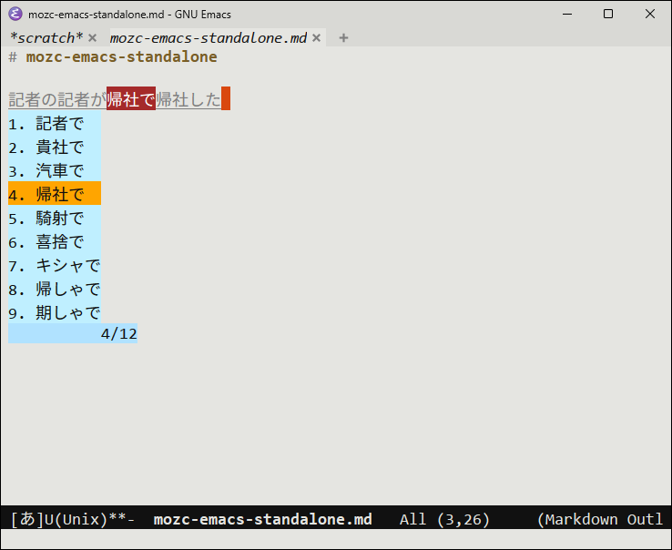
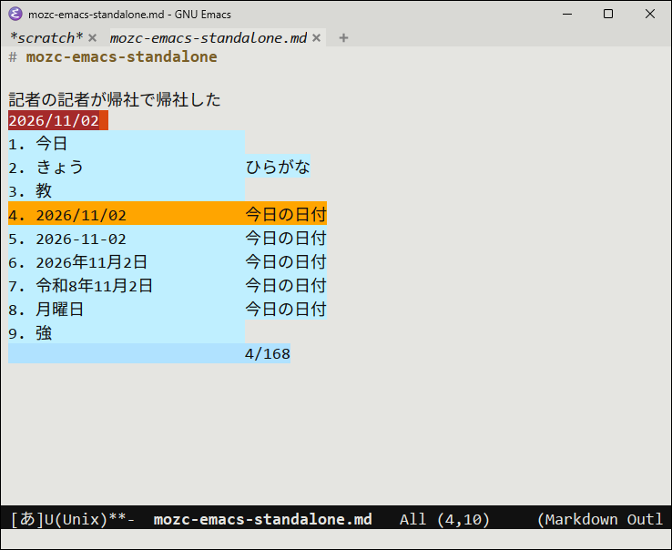
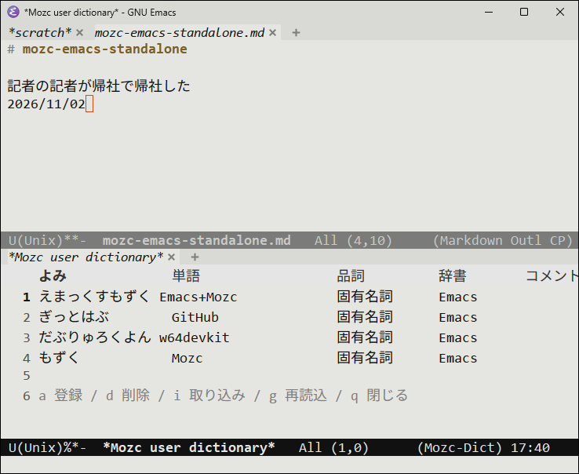

[](https://opensource.org/licenses/BSD-3-Clause)
[](https://zenn.dev/kurouna)
[](https://x.com/elecxzy)

[English](README.md) | **日本語**

# mozc-emacs-standalone

Windows の GNU Emacs で、[Mozc](https://github.com/google/mozc) を `C-\` の
入力メソッドとして使うためのビルドキットです。Mozc の変換エンジンと辞書を
内蔵した `mozc_emacs_helper.exe` を、[w64devkit](https://github.com/skeeto/w64devkit)
の gcc だけでビルドします。

<table>
  <tr>
    <td></td>
    <td></td>
  </tr>
  <tr>
    <td align="center">同音異義語も文節ごとに</td>
    <td align="center">日付・郵便番号・計算・絵文字も</td>
  </tr>
</table>

- IME のインストールも、変換サーバー (`mozc_server`) も要りません
- Emacs 側は Mozc 公式の `mozc.el` をそのまま使います（GUI でも `-nw` でも同じ）
- Bazel も MSVC も使いません
- Mozc 公式の辞書ツール（GUI）の代わりに、Emacs Lisp だけで書いたユーザー辞書の編集機能（`mozc-user-dict.el`）があります

このリポジトリにあるのはビルドスクリプト・パッチ・追加ソースだけで、Mozc 本体と辞書は
ビルド時に各配布元から取得します。ビルド済みの zip は [Releases](https://github.com/kurouna/mozc-emacs-standalone/releases) から入手できます。

## 仕組み

Mozc 公式の `mozc_emacs_helper` は、別プロセスの変換サーバーに IPC でつなぐ
中継役です。Windows 向けには配布されていません。

```
公式:   Emacs ─(S式)─ mozc_emacs_helper ─(IPC)─ mozc_server（エンジン＋辞書）
これ:   Emacs ─(S式)─ mozc_emacs_helper.exe（エンジン＋辞書を内蔵）
```

ここでビルドする helper は、サーバーの中で動いている `SessionHandler` を
自分の中に持ち、変換を自分で行います。`mozc.el` とのやり取り（標準入出力の
S 式）は公式と同じなので、Emacs 側は公式の `mozc.el` がそのまま使えます。

| 項目 | 公式 `mozc_emacs_helper` | これ |
|:---|:---|:---|
| 変換する場所 | `mozc_server`（別プロセス） | helper の中 |
| 前提 | Mozc / Google 日本語入力のインストール | exe 1 つ（約 26MB） |
| 辞書 | サーバー側のもの | Mozc のオープンソース版の辞書 |
| 学習・ユーザー辞書 | サーバーと共有（他のアプリと共通） | helper 専用（`%USERPROFILE%\AppData\LocalLow\Mozc\`） |

## ダウンロード

[Releases](https://github.com/kurouna/mozc-emacs-standalone/releases) から `mozc-emacs-standalone-<版>-win-x64.zip` を入手して展開します。

| ファイル | 内容 |
|:---|:---|
| `mozc_emacs_helper.exe` | Mozc の変換エンジンと辞書を内蔵した helper |
| `mozc.el` | 同じ版の Mozc 公式 `mozc.el` |
| `mozc-user-dict.el` | Emacs からユーザー辞書を編集する（[下記](#ユーザー辞書)）。v0.0.3 から同梱 |
| `LICENSES\` | exe に含まれるもののライセンス文。exe を人に渡すときは一緒に渡してください |
| `README.md` / `README.ja.md` | この説明 |

`mozc.el` と `mozc_emacs_helper.exe` を好きな場所に置き、[Emacs で使う](#emacs-で使う) の
とおりに設定します。自分でビルドする場合は、以下を読み進めてください。

## 必要なもの

- [w64devkit](https://github.com/skeeto/w64devkit/releases)（gcc / cmake / ninja / sh を含む）。
  `w64devkit-x64-*.7z.exe` を展開するだけで使えます
- git
- Python 3（`PATH` 上の `python`）と absl-py（`python -m pip install absl-py`）
- インターネット接続（Mozc・abseil・protobuf・WIL・辞書の元データを取得します）

## ビルド

PowerShell で実行します。

```powershell
git clone https://github.com/kurouna/mozc-emacs-standalone.git
cd mozc-emacs-standalone
.\build.ps1
# w64devkit を別の場所に置いた場合 / 作業ディレクトリや出力先を変える場合
.\build.ps1 -DevkitBin C:\w64devkit\bin -WorkDir D:\mozc-build -OutDir $env:APPDATA\.emacs.d\mozc
```

`-OutDir`（既定は `.\dist`）に次のものができます。初回は abseil / protobuf の
ビルドを含めて 10〜20 分ほどかかります。

| ファイル | 内容 |
|:---|:---|
| `mozc_emacs_helper.exe` | エンジンと辞書を内蔵した helper。Windows 標準の DLL にしか依存しない |
| `mozc.el` | 同じ版の Mozc 公式 `src/unix/emacs/mozc.el`。1 行目に `-*- lexical-binding: nil -*-` だけ足してある（Emacs 31 の `Missing lexical-binding cookie` 警告対策。動作は変わらない） |
| `mozc-user-dict.el` | Emacs からユーザー辞書を編集する（[下記](#ユーザー辞書)） |
| `LICENSES\` | exe に含まれるもののライセンス文。exe を人に渡すときは一緒に渡してください |

作業ディレクトリ（既定は `%TEMP%\mozc-build`）を残しておけば、2 回目以降は
差分だけをビルドします。Emacs が helper を使っている間も実行でき、使用中の
exe は `mozc_emacs_helper.exe.old` に退避して差し替えます（Emacs を再起動すると
新しい exe が使われます）。

## Emacs で使う

`mozc.el` と `mozc_emacs_helper.exe` を置いた場所（例では `~/.emacs.d/mozc/`）を
指定します。

```elisp
(add-to-list 'load-path (expand-file-name "mozc" user-emacs-directory))
(require 'mozc)
(setq mozc-helper-program-name
      (expand-file-name "mozc/mozc_emacs_helper.exe" user-emacs-directory))
(setq default-input-method "japanese-mozc")
(require 'mozc-user-dict)   ; 任意: ユーザー辞書の編集
```

これで `C-\` で ON/OFF できます。変換中はスペースで変換・候補送り、Enter で確定、
F7 でカタカナ、→ で次の文節です。日付（「きょう」）・郵便番号・計算（`12*3+4=`）・
絵文字なども Mozc と同じように変換できます。

- 学習結果は `%USERPROFILE%\AppData\LocalLow\Mozc\` に保存されます。消せば学習前に戻ります
- 絵文字が `01F431` のような 16 進の箱で出る場合は、絵文字用のフォントを指定します

  ```elisp
  (set-fontset-font t 'emoji (font-spec :family "Segoe UI Emoji") nil 'prepend)
  ```

- [tr-ime](https://github.com/trueroad/tr-emacs-ime-module) と併用する場合、
  tr-ime の IME 状態の同期は「Windows の IME が閉じているのに入力メソッドが有効」
  を食い違いとみなして Mozc を OFF にしてしまいます。Mozc を使う間は、半角/全角
  キーで Windows の IME が開いたときに Mozc を切り替えるよう差し替えると併用できます

  ```elisp
  (with-eval-after-load 'tr-ime-sync
    (advice-add 'tr-ime-sync--setopenstatus :around
                (lambda (orig)
                  (if (not (equal default-input-method "japanese-mozc"))
                      (funcall orig)
                    (tr-ime-hook-check)
                    (when (tr-ime-openstatus-get-mode)
                      (tr-ime-openstatus-force-off)
                      (toggle-input-method))))))
  ```

### ユーザー辞書

Mozc 公式の辞書ツールは Qt で作られた別の GUI アプリで、このキットではビルドしません。
代わりに `mozc-user-dict.el` が、ユーザー辞書（`%USERPROFILE%\AppData\LocalLow\Mozc\user_dictionary.db`）
を Emacs Lisp だけで読み書きし、書き換えたら helper を再起動して読み直させます
（mozc.el は再起動を検知してセッションを作り直します）。

<p align="center">
  
</p>

| コマンド | 動作 |
|:---|:---|
| `M-x mozc-user-dict-add` | 単語・よみ・品詞・コメントを聞いて登録（範囲選択中ならその文字列を単語の既定値に） |
| `M-x mozc-user-dict-list` | 一覧。`a` 登録 / `d` 削除 / `i` 取り込み / `g` 再読込 / `q` 閉じる |
| `M-x mozc-user-dict-import` | テキスト辞書を取り込む（下記） |

- 登録先は `Emacs` という名前の辞書です（無ければ作ります。`mozc-user-dict-name` で変更可）。
  ほかの辞書の単語も一覧・削除できます
- 品詞は Mozc と同じ 45 種類から補完で選びます（既定は名詞）。よみの入力中も `C-\` で Mozc を使えます
- 取り込めるのは 1 行 1 語の「よみ<TAB>単語<TAB>品詞<TAB>コメント」形式です（品詞とコメントは省略可）。
  Microsoft IME で「テキストファイルで出力」したもの（UTF-16、`!` で始まる行）もそのまま読めます。
  Mozc に無い品詞は名詞にします
- 辞書ファイルは protobuf をそのまま書いたもので、知らない項目も読んだまま書き戻すので、
  Mozc の版が上がって項目が増えても壊しません

### 動作確認

helper 単体で、「かんじ」を変換・確定できるかを確かめられます。最後の行に
`(result ...)` が出れば OK です。

```powershell
"(0 CreateSession)`n(1 SendKey 1 107)`n(2 SendKey 1 97)`n(3 SendKey 1 110)`n(4 SendKey 1 106)`n(5 SendKey 1 105)`n(6 SendKey 1 space)`n(7 SendKey 1 enter)" | .\dist\mozc_emacs_helper.exe --suppress_stderr
```

## 中身

| パス | 内容 |
|:---|:---|
| `build.ps1` | ビルドスクリプト。使う Mozc・abseil・protobuf・WIL・辞書の元データの版を先頭で固定している |
| `mini_bazel.py` | Mozc の `BUILD.bazel` を評価して `build.ninja` を生成する。Bazel のうち Mozc のエンジンと辞書データの生成に要る部分だけを実装 |
| `patches/` | MinGW の gcc で通すための Mozc へのパッチ（`__try`/`__except` と、ファイルを開く処理） |
| `emacs_standalone/` | Mozc のソースツリーに足すパッケージ。エンジン内蔵の helper 本体と、MinGW に無い ATL / aux_ulib を使う部分の代替実装 |
| `compat/` | MinGW に無いヘッダの代わり（`atlbase.h` / `aux_ulib.h`） |
| `mozc-user-dict.el` | Emacs からユーザー辞書を編集する（`build.ps1` が `-OutDir` にコピーする） |

helper で手を入れているのは次の 2 点です。

- `mozc.el` とのやり取りはセッション ID が 32 ビット、エンジン内部は 64 ビットなので、
  公式 helper と同じく対応表を持たせています
- Windows 版の Mozc はセッションを IME OFF の状態で始めます。`mozc.el` は Linux 版と
  同じく ON の状態を前提にしているので、セッション作成直後に ON にしています

## Mozc を新しい版に更新する

1. 使う Mozc のコミットを決め、`build.ps1` 先頭の `$mozc` のコミットハッシュ（40 桁）を書き換えます。
2. `.\build.ps1` を実行します。Mozc の `src/MODULE.bazel` が要求する abseil / protobuf の版や、
   辞書データの元になる外部ファイル（郵便番号データ・用例辞書）の SHA-256 が `build.ps1` の
   固定値と違うと、直すべき値を表示して止まるので、`$abseil` / `$protobuf` / `$externals` を
   MODULE.bazel に合わせて再実行します（abseil / protobuf は自動で作り直されます）。
   MODULE.bazel に外部ファイルが増えた場合は `mini_bazel.py` が「見つからない」と止まるので、
   その `http_archive` を `$externals` に足します。
3. 上の「動作確認」と、Emacs での入力・変換を確かめます。

ビルドが通らないときは、失敗した段階で直す場所が決まっています。作業ディレクトリの
`mozc\` は Mozc のソース（パッチ適用済み）、`out\` は ninja のビルドディレクトリで、
`out\` で `ninja` を直接実行すれば失敗した所だけをやり直せます（その場合は
`$env:PYTHONPATH` に `mozc\src` を設定し、w64devkit の `bin` を `PATH` の先頭に）。

| 失敗した段階 | 直す場所 |
|:---|:---|
| `git apply`（パッチが当たらない） | 作業ディレクトリの `mozc\` で `git checkout -- .` してから同じ修正をし直し、`git diff > patches\0001-build-with-mingw-gcc.patch` で作り直す |
| `mini_bazel.py`（BUILD の評価） | Mozc が新しいルール・マクロを使い始めた。`mini_bazel.py` の `BASE_ENV` にスタブを足す（未知の名前は何もしないルールとして扱われるので、出力を生むものだけ実装が要る） |
| コンパイル | MSVC 専用の書き方が増えた。小さければ `patches/` に追加、ATL などファイルごと通らなければ `mini_bazel.py` の `SRC_OVERRIDES` / `EXTRA_SRCS` で `emacs_standalone/` の代替実装に差し替える。WIL が原因なら `$wil` を新しいコミットに |
| リンク（`undefined reference`） | 足りない Windows のライブラリを `mini_bazel.py` の `HEADER` の `syslibs` に足す。MinGW に無い関数なら `emacs_standalone/` に代替実装を置き、`EXTRA_SRCS` で足す |
| 辞書データの生成 | ninja が実行したコマンドは `out\cmds\*.sh` にある。`out\` で `sh cmds\<名前>.sh` を実行すると単独で再現できる |
| helper は動くが `mozc.el` で使えない | `emacs_standalone/mozc_emacs_helper_standalone.cc` を、Mozc 公式の `src/unix/emacs/mozc_emacs_helper.cc` の変更に合わせる（S 式の処理自体は Mozc 側の `mozc_emacs_helper_lib` をそのまま使っている） |

## License / ライセンス

This software is released under the [BSD 3-Clause License](./LICENSE). `emacs_standalone/mozc_emacs_helper_standalone.cc`
and `patches/` are derived from Mozc; the Mozc copyright notice is in [LICENSE.mozc](./LICENSE.mozc).  
本ソフトウェアは [BSD 3-Clause License](./LICENSE) のもとで公開されています。`emacs_standalone/mozc_emacs_helper_standalone.cc`
と `patches/` は Mozc を元にしており、Mozc の著作権表示は [LICENSE.mozc](./LICENSE.mozc) にあります。

リポジトリ自体には Mozc 本体と辞書は含まれません。リリースの zip に入っている
`mozc_emacs_helper.exe` にも、自分でビルドしたものにも、次のものが含まれます。
ライセンス文は zip の `LICENSES\` にあり、`build.ps1` も `-OutDir` の `LICENSES\` に
書き出します。exe を人に渡すときは一緒に渡してください。

| 含まれるもの | ライセンス |
|:---|:---|
| Mozc | BSD 3-Clause |
| Mozc の辞書データ（IPAdic・沖縄辞書ほか） | IPAdic / 沖縄辞書のライセンス（`mozc-dictionary_oss.README.txt`） |
| 用例辞書 (japanese-usage-dictionary) | BSD 2-Clause |
| abseil-cpp | Apache License 2.0 |
| protobuf | BSD 3-Clause |
| WIL (Windows Implementation Libraries) | MIT |
| MinGW-w64 ランタイム（スタートアップコード・winpthreads） | MinGW-w64 ランタイムのライセンス（`MinGW-w64-runtime.txt`） |

郵便番号辞書は日本郵便の郵便番号データから生成されます。

## Acknowledgements / 謝辞

This project is built on the following software. We express our utmost respect and gratitude to
its creators and contributors:

本プロジェクトは、以下のソフトウェアの上に成り立っています。これらを生み出した開発者および
コミュニティの皆様に、最大限の敬意と謝意を表します。

- **[Mozc](https://github.com/google/mozc)**
  - Copyright 2010-2021, Google Inc.
  - Licensed under the BSD 3-Clause License
- **[w64devkit](https://github.com/skeeto/w64devkit)** — Christopher Wellons

このプロジェクトは Google とは関係のない、個人によるものです。  
This project is not affiliated with Google.

---

<p align="center">Copyright © 2026 elecxzy project</p>
