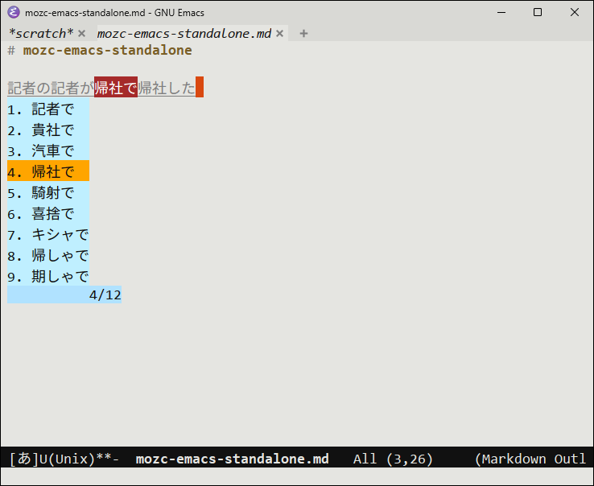
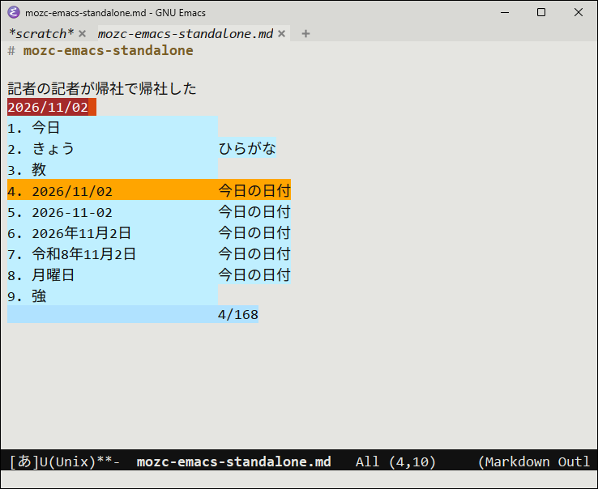
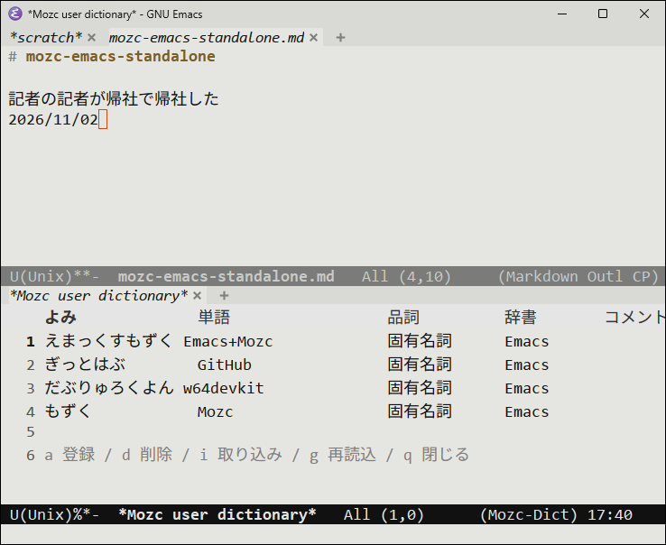

[](https://opensource.org/licenses/BSD-3-Clause)
[](https://zenn.dev/kurouna)
[](https://x.com/elecxzy)

**English** | [日本語](README.ja.md)

# mozc-emacs-standalone

A build kit for using [Mozc](https://github.com/google/mozc) as a `C-\` input method in GNU Emacs
on Windows. It builds a `mozc_emacs_helper.exe` with the Mozc conversion engine and dictionary
linked in, using only the gcc of [w64devkit](https://github.com/skeeto/w64devkit).

<table>
  <tr>
    <td></td>
    <td></td>
  </tr>
  <tr>
    <td align="center">Homophones, segment by segment</td>
    <td align="center">Dates, postal codes, calculations and emoji too</td>
  </tr>
</table>

- No IME to install and no conversion server (`mozc_server`)
- Emacs uses Mozc's official `mozc.el` as is, in GUI and in `-nw`
- No Bazel and no MSVC
- A user dictionary editor in pure Emacs Lisp (`mozc-user-dict.el`) instead of Mozc's GUI dictionary tool

This repository contains only the build script, patches and extra sources; the build fetches
Mozc and its dictionary from their upstream sources. A prebuilt zip is available from
[Releases](https://github.com/kurouna/mozc-emacs-standalone/releases).

## How it works

Mozc's official `mozc_emacs_helper` is a relay that talks to a separate conversion server over
IPC, and it is not distributed for Windows.

```
official:  Emacs ─(S-exp)─ mozc_emacs_helper ─(IPC)─ mozc_server (engine + dictionary)
this:      Emacs ─(S-exp)─ mozc_emacs_helper.exe (engine + dictionary inside)
```

The helper built here holds the `SessionHandler` that normally runs inside the server and does
the conversion itself. It speaks the same S-expression protocol over stdin/stdout as the official
helper, so the official `mozc.el` works with it unchanged.

| | Official `mozc_emacs_helper` | This |
|:---|:---|:---|
| Where conversion runs | `mozc_server` (separate process) | inside the helper |
| Requires | Mozc / Google Japanese Input installed | one exe (about 26 MB) |
| Dictionary | the server's | Mozc's open-source dictionary |
| Learning and user dictionary | shared with the server (and other apps) | the helper's own (`%USERPROFILE%\AppData\LocalLow\Mozc\`) |

## Download

Get `mozc-emacs-standalone-<version>-win-x64.zip` from [Releases](https://github.com/kurouna/mozc-emacs-standalone/releases) and extract it.

| File | Contents |
|:---|:---|
| `mozc_emacs_helper.exe` | The helper with the Mozc engine and dictionary inside |
| `mozc.el` | Mozc's official `mozc.el` of the same version |
| `mozc-user-dict.el` | Edits the user dictionary from Emacs ([below](#user-dictionary)). Included since v0.0.3 |
| `LICENSES\` | License texts of what the exe contains. Keep them with the exe when you pass it on |
| `README.md` / `README.ja.md` | This document |

Put `mozc.el` and `mozc_emacs_helper.exe` somewhere and set up Emacs as in
[Use from Emacs](#use-from-emacs). To build it yourself, read on.

## Requirements

- [w64devkit](https://github.com/skeeto/w64devkit/releases) (includes gcc, cmake, ninja and sh);
  just extract `w64devkit-x64-*.7z.exe`
- git
- Python 3 (`python` on `PATH`) with absl-py (`python -m pip install absl-py`)
- An internet connection (to fetch Mozc, abseil, protobuf, WIL and the dictionary sources)

## Build

Run in PowerShell.

```powershell
git clone https://github.com/kurouna/mozc-emacs-standalone.git
cd mozc-emacs-standalone
.\build.ps1
# w64devkit elsewhere / another work directory or output directory
.\build.ps1 -DevkitBin C:\w64devkit\bin -WorkDir D:\mozc-build -OutDir $env:APPDATA\.emacs.d\mozc
```

The following are written to `-OutDir` (default `.\dist`). The first build takes 10-20 minutes,
including abseil and protobuf.

| File | Contents |
|:---|:---|
| `mozc_emacs_helper.exe` | The helper with the engine and dictionary inside. Depends only on Windows system DLLs |
| `mozc.el` | Mozc's official `src/unix/emacs/mozc.el` of the same version, with only `-*- lexical-binding: nil -*-` added to the first line (silences Emacs 31's `Missing lexical-binding cookie` warning; behavior is unchanged) |
| `mozc-user-dict.el` | Edits the user dictionary from Emacs ([below](#user-dictionary)) |
| `LICENSES\` | License texts of what the exe contains. Pass them along with the exe |

Keep the work directory (default `%TEMP%\mozc-build`) and later builds are incremental. You can
build while Emacs is using the helper: the exe in use is moved to `mozc_emacs_helper.exe.old`
and replaced, and Emacs picks up the new one after a restart.

## Use from Emacs

Point Emacs to where you put `mozc.el` and `mozc_emacs_helper.exe` (`~/.emacs.d/mozc/` here).

```elisp
(add-to-list 'load-path (expand-file-name "mozc" user-emacs-directory))
(require 'mozc)
(setq mozc-helper-program-name
      (expand-file-name "mozc/mozc_emacs_helper.exe" user-emacs-directory))
(setq default-input-method "japanese-mozc")
(require 'mozc-user-dict)   ; optional: edit the user dictionary
```

`C-\` toggles it. While converting: Space converts and cycles candidates, Enter commits, F7 gives
katakana, and Right moves to the next segment. Dates (`kyou`), postal codes, calculations
(`12*3+4=`) and emoji convert as in Mozc.

- Learning is stored in `%USERPROFILE%\AppData\LocalLow\Mozc\`; delete it to start over
- If emoji appear as hex boxes such as `01F431`, set an emoji font

  ```elisp
  (set-fontset-font t 'emoji (font-spec :family "Segoe UI Emoji") nil 'prepend)
  ```

- With [tr-ime](https://github.com/trueroad/tr-emacs-ime-module), its IME state sync treats
  "the Windows IME is closed while an input method is active" as a mismatch and turns Mozc off.
  While Mozc is used, replace the sync so that opening the Windows IME (e.g. with the
  Hankaku/Zenkaku key) toggles Mozc instead

  ```elisp
  (with-eval-after-load 'tr-ime-sync
    (advice-add 'tr-ime-sync--setopenstatus :around
                (lambda (orig)
                  (if (not (equal default-input-method "japanese-mozc"))
                      (funcall orig)
                    (tr-ime-hook-check)
                    (when (tr-ime-openstatus-get-mode)
                      (tr-ime-openstatus-force-off)
                      (toggle-input-method))))))
  ```

### User dictionary

Mozc's dictionary tool is a separate Qt GUI that this kit does not build. Instead,
`mozc-user-dict.el` reads and writes the user dictionary
(`%USERPROFILE%\AppData\LocalLow\Mozc\user_dictionary.db`) in pure Emacs Lisp, then restarts the
helper so that it reloads the dictionary (`mozc.el` notices the restart and recreates its sessions).

<p align="center">
  
</p>

| Command | Action |
|:---|:---|
| `M-x mozc-user-dict-add` | Asks for the word, reading, part of speech and comment, and registers it (the active region becomes the default word) |
| `M-x mozc-user-dict-list` | Lists the words. `a` add / `d` delete / `i` import / `g` refresh / `q` quit |
| `M-x mozc-user-dict-import` | Imports a text dictionary (below) |

- Words go to a dictionary named `Emacs` (created if missing; change `mozc-user-dict-name`).
  Words in other dictionaries can be listed and deleted too
- The part of speech is one of Mozc's 45 kinds, chosen with completion (default 名詞, noun).
  You can turn Mozc on with `C-\` while typing the reading
- Imports take one word per line, `reading<TAB>word<TAB>part of speech<TAB>comment` (the last two
  are optional). Files exported by Microsoft IME as text (UTF-16, lines starting with `!`) work as
  they are. Parts of speech Mozc does not have become nouns
- The file is the protobuf message as is. Fields this code does not know are written back
  unchanged, so new fields in later Mozc versions survive

### Check

Converts the reading kanji and commits it. You are fine if the last line has `(result ...)`.

```powershell
"(0 CreateSession)`n(1 SendKey 1 107)`n(2 SendKey 1 97)`n(3 SendKey 1 110)`n(4 SendKey 1 106)`n(5 SendKey 1 105)`n(6 SendKey 1 space)`n(7 SendKey 1 enter)" | .\dist\mozc_emacs_helper.exe --suppress_stderr
```

## Contents

| Path | Contents |
|:---|:---|
| `build.ps1` | The build script. Pins the versions of Mozc, abseil, protobuf, WIL and the dictionary sources at the top |
| `mini_bazel.py` | Evaluates Mozc's `BUILD.bazel` files and writes `build.ninja`. Implements only the part of Bazel the engine and the dictionary generation need |
| `patches/` | Patches to Mozc for MinGW gcc (`__try`/`__except` and opening files) |
| `emacs_standalone/` | A package added to the Mozc tree: the engine-embedded helper, and replacements for code that needs ATL or aux_ulib, which MinGW lacks |
| `compat/` | Stand-ins for headers MinGW lacks (`atlbase.h`, `aux_ulib.h`) |
| `mozc-user-dict.el` | Edits the user dictionary from Emacs (`build.ps1` copies it to `-OutDir`) |

The helper adds two things to the official one:

- `mozc.el` uses 32-bit session ids and the engine 64-bit ones, so it keeps a map between them,
  as the official helper does
- Mozc on Windows starts a session with the IME off; `mozc.el` expects it on as on Linux, so the
  helper turns it on right after creating the session

## Updating Mozc

1. Pick a Mozc commit and set the 40-digit hash in `$mozc` at the top of `build.ps1`.
2. Run `.\build.ps1`. If the abseil or protobuf versions, or the SHA-256 of the dictionary
   sources (postal code data, usage dictionary), required by Mozc's `src/MODULE.bazel` differ from
   those pinned in `build.ps1`, it stops and shows the values to change. Update `$abseil`,
   `$protobuf` and `$externals` to match and run it again (abseil and protobuf are rebuilt
   automatically). If MODULE.bazel adds an external file, `mini_bazel.py` stops with "not found";
   add that `http_archive` to `$externals`.
3. Run the check above and try typing in Emacs.

When the build fails, where to fix depends on the stage. In the work directory, `mozc\` is the
patched Mozc source and `out\` is the ninja build directory; running `ninja` in `out\` redoes only
what failed (set `$env:PYTHONPATH` to `mozc\src` and put w64devkit's `bin` first in `PATH`).

| Failed stage | Where to fix |
|:---|:---|
| `git apply` (patch does not apply) | In `mozc\` of the work directory, `git checkout -- .`, redo the changes and regenerate with `git diff > patches\0001-build-with-mingw-gcc.patch` |
| `mini_bazel.py` (evaluating BUILD) | Mozc uses a new rule or macro. Add a stub to `BASE_ENV` in `mini_bazel.py` (unknown names become no-op rules, so only ones that produce outputs need an implementation) |
| Compile | More MSVC-only code. Add small fixes to `patches/`; for whole files that cannot build (e.g. ATL), swap in a replacement under `emacs_standalone/` via `SRC_OVERRIDES` / `EXTRA_SRCS` in `mini_bazel.py`. If WIL is the cause, move `$wil` to a newer commit |
| Link (`undefined reference`) | Add the missing Windows library to `syslibs` in `HEADER` of `mini_bazel.py`. For a function MinGW lacks, put a replacement in `emacs_standalone/` and add it with `EXTRA_SRCS` |
| Dictionary data generation | The commands ninja ran are in `out\cmds\*.sh`; run `sh cmds\<name>.sh` in `out\` to reproduce one alone |
| The helper runs but `mozc.el` cannot use it | Follow changes to Mozc's `src/unix/emacs/mozc_emacs_helper.cc` in `emacs_standalone/mozc_emacs_helper_standalone.cc` (the S-expression handling itself is Mozc's `mozc_emacs_helper_lib`) |

## License / ライセンス

This software is released under the [BSD 3-Clause License](./LICENSE). `emacs_standalone/mozc_emacs_helper_standalone.cc`
and `patches/` are derived from Mozc; the Mozc copyright notice is in [LICENSE.mozc](./LICENSE.mozc).  
本ソフトウェアは [BSD 3-Clause License](./LICENSE) のもとで公開されています。`emacs_standalone/mozc_emacs_helper_standalone.cc`
と `patches/` は Mozc を元にしており、Mozc の著作権表示は [LICENSE.mozc](./LICENSE.mozc) にあります。

The repository itself does not contain Mozc or its dictionary. `mozc_emacs_helper.exe`, both the
one in the release zip and one you build, contains the following. Their license texts are in
`LICENSES\` of the zip, and `build.ps1` writes them to `LICENSES\` in `-OutDir`. Pass them along
with the exe.

| Contained | License |
|:---|:---|
| Mozc | BSD 3-Clause |
| Mozc dictionary data (IPAdic, Okinawa dictionary and others) | IPAdic / Okinawa dictionary licenses (`mozc-dictionary_oss.README.txt`) |
| Usage dictionary (japanese-usage-dictionary) | BSD 2-Clause |
| abseil-cpp | Apache License 2.0 |
| protobuf | BSD 3-Clause |
| WIL (Windows Implementation Libraries) | MIT |
| MinGW-w64 runtime (startup code, winpthreads) | MinGW-w64 runtime licenses (`MinGW-w64-runtime.txt`) |

The postal code dictionary is generated from Japan Post's postal code data.

## Acknowledgements / 謝辞

This project is built on the following software. We express our utmost respect and gratitude to
its creators and contributors:

本プロジェクトは、以下のソフトウェアの上に成り立っています。これらを生み出した開発者および
コミュニティの皆様に、最大限の敬意と謝意を表します。

- **[Mozc](https://github.com/google/mozc)**
  - Copyright 2010-2021, Google Inc.
  - Licensed under the BSD 3-Clause License
- **[w64devkit](https://github.com/skeeto/w64devkit)** — Christopher Wellons

This project is not affiliated with Google.  
このプロジェクトは Google とは関係のない、個人によるものです。

---

<p align="center">Copyright © 2026 elecxzy project</p>
